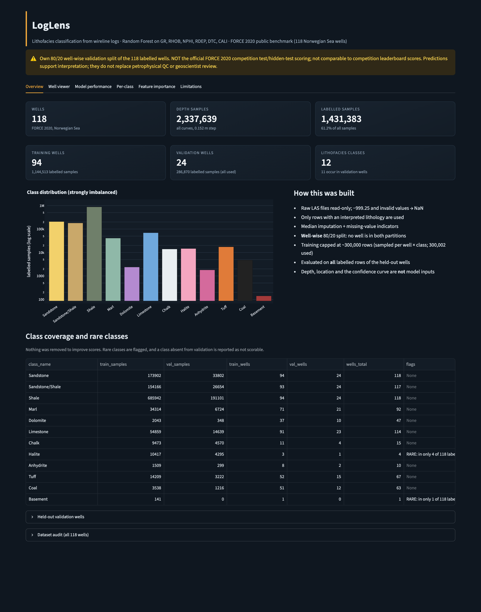
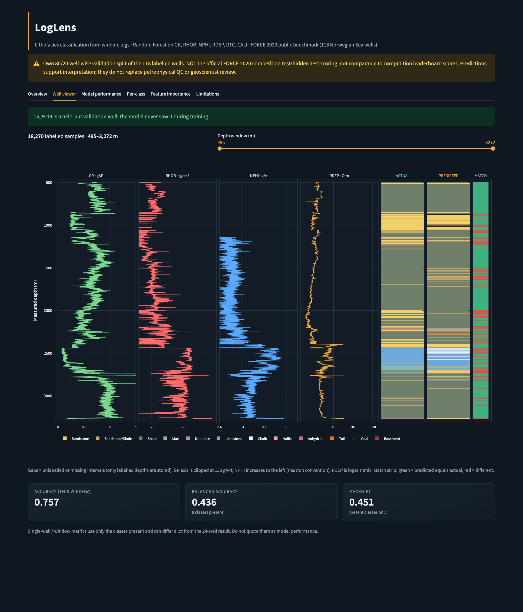
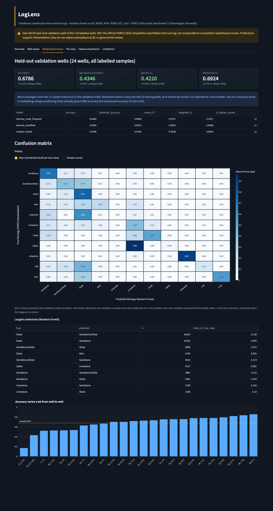
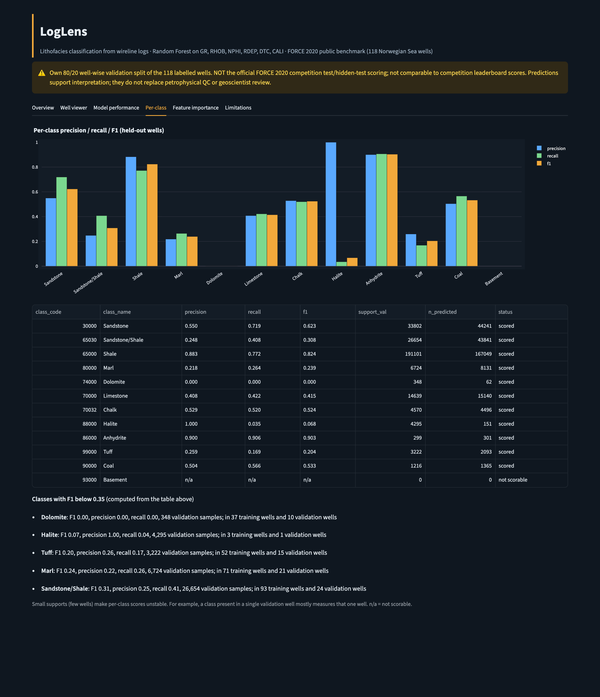

# LogLens

**Machine-learning-assisted lithofacies classification from wireline logs**

LogLens classifies interpreted lithofacies from conventional wireline logs (GR, RHOB, NPHI, RDEP, DTC, CALI) using the public **FORCE 2020 well log and lithofacies dataset** (118 wells, Norwegian Sea). It combines a reproducible training and evaluation pipeline, a well-wise validation design and a Streamlit dashboard for inspecting results on depth tracks.

> **Disclaimer.** LogLens is an independent student research prototype developed for educational and research purposes. It is a machine-learning-based lithofacies classification and decision-support application, not a commercial-grade petrophysical interpretation system.

## Results (LogLens v1.0)

Evaluated on **24 held-out wells** (286,870 labelled samples) from LogLens' own 80/20 well-wise split. These are **not** official FORCE 2020 competition scores and must not be compared with its leaderboard.

| Model | Accuracy | Balanced accuracy | Macro-F1 | Weighted-F1 |
|---|---|---|---|---|
| Baseline: always predict most frequent class (Shale) | 0.6662 | 0.0909 | 0.0727 | 0.5327 |
| Baseline: stratified random | 0.4345 | 0.0910 | 0.0901 | 0.4508 |
| **Random Forest** | **0.6786** | **0.4346** | **0.4220** | **0.6924** |

Macro averages cover the 11 classes present in the validation wells (Basement occurs in a single training well and cannot be scored).

Accuracy alone is misleading: Shale is about 66 % of the validation samples, so always predicting Shale already reaches 0.666 accuracy. The Random Forest's real gain is in balanced accuracy and macro-F1. Several lithologies are still identified poorly (Dolomite F1 0.00, Halite 0.07, Tuff 0.20, Marl 0.24, Sandstone/Shale 0.31). Full per-class results, confusion analysis and limitations: **[RESULTS_SUMMARY.md](RESULTS_SUMMARY.md)**. Per-class table (Basement shown as *not scorable*, not 0): [models/v1/PER_CLASS_REPORT.md](models/v1/PER_CLASS_REPORT.md).

## Dashboard

Six tabs: Overview, Well viewer, Model performance, Per-class, Feature importance, Limitations.






## Methodology

- **Data:** FORCE 2020 LAS files (public benchmark, 2,337,639 depth samples, 1,431,383 with an interpreted lithology label, 12 lithofacies classes). Class names follow the competition's own `lithology_keys` mapping.
- **Features:** GR, RHOB, NPHI, RDEP, DTC, CALI, the six curves present in all 118 wells. Well name, depth, x/y/z location and the label-confidence curve are **not** model inputs.
- **Preprocessing:** −999.25 and invalid values (non-positive RHOB, RDEP, DTC, CALI) become NaN; rows without a lithology label are dropped (in derived copies only; LAS files are never modified); median imputation with missing-value indicators inside a scikit-learn `Pipeline`.
- **Models:** `DummyClassifier` baselines versus `RandomForestClassifier(n_estimators=150, max_depth=24, min_samples_leaf=3, class_weight='balanced_subsample', random_state=42)`. Training uses at most ~300,000 rows, sampled per (well, class) so no well/class combination disappears; evaluation uses **all** labelled rows of the held-out wells.
- **Metrics:** accuracy, balanced accuracy, macro-F1, weighted-F1, per-class precision/recall/F1, confusion matrices. A class with no validation samples is reported as *not scorable*, never as 0.
- **Reproducibility:** seeds, package versions, the exact training and validation well lists and the model configuration are saved in `models/v1/`.

### Why validation is well-wise
Depth samples 0.152 m apart within one well are almost duplicates. A random row split would place near-copies in both training and test sets and overstate performance. LogLens holds out complete wells (`GroupShuffleSplit`, 80/20, seed 42: 94 training and 24 validation wells, no overlap; verified by `src/audit_results.py`). One split is still a single estimate; repeated grouped cross-validation is future work.

Design reasoning (why these curves, why imputation, why Random Forest): [docs/LOGLENS_V1_ENGINEERING_NOTES.md](docs/LOGLENS_V1_ENGINEERING_NOTES.md).

## Limitations (summary)

- Single 80/20 well-wise split; no repeated cross-validation or hyper-parameter tuning.
- Not the official FORCE 2020 test scoring.
- Each depth sample is classified independently; bed continuity is ignored.
- Rare classes (Basement 1 well, Halite 4 wells) give unstable or no scores.
- Labels are expert interpretations, not core-verified truth.
- Median imputation is not a petrophysical estimate.
- Predictions are decision support and do not replace petrophysical interpretation or geoscientist review.

The complete list is in [RESULTS_SUMMARY.md](RESULTS_SUMMARY.md).

## Quick start

Tested with **Python 3.13.7** and the exact package versions pinned in `requirements.txt` (NumPy 2.5.5, pandas 3.1.1, scikit-learn 1.9.1, Streamlit 1.67.0, Plotly 7.2.0, Matplotlib 3.11.2, Joblib 1.6.0, pytest 9.2.0).

```bash
git clone https://github.com/Spooky10L/LogLens-Lithofacies-Classification LogLens_AI
cd LogLens_AI
python3 -m venv .venv
source .venv/bin/activate
pip install -r requirements.txt
```

**Get the data (not included in this repository).** Download `LAS_files_Force_2020_all_wells_train_test_blind_hidden_final.zip` from the Zenodo record below and extract it to `data/force_las/`. Keep the original archive unchanged.

**Reproduce the results:**

```bash
python -m src.audit_force_las data/force_las --output data/audit   # read-only dataset audit
python -m src.force_v1 --data data/force_las --output models/v1    # train + evaluate (a few minutes)
python -m src.audit_results                                         # recompute metrics from saved predictions
python -m src.publish_report                                        # per-class report (Basement = not scorable)
pytest -q
```

**Launch the dashboard:**

```bash
streamlit run app.py
```

It opens at http://localhost:8501, reads the saved results in `models/v1/` (plus `data/processed/` and `data/audit/` when present) and never retrains. Held-out wells show genuine predictions; training wells are marked in-sample. The small metric tables and plots in `models/v1/` are committed; the trained model (~750 MB) and the large prediction files are regenerated by the training command.

## Project structure

```
app.py                  Streamlit dashboard (6 tabs)
src/force_v1.py         v1 preprocessing, well-wise split, training, evaluation, plots
src/audit_force_las.py  read-only audit of the LAS files
src/audit_results.py    re-computes saved metrics, checks well overlap
src/publish_report.py   per-class publication report from the saved results
src/dashboard_data.py   dashboard data loading (tested)
src/dashboard_plots.py  dashboard figures (tested)
tests/                  pytest suite
models/v1/              metrics, per-class report, confusion matrices, plots, well lists
data/audit/             dataset audit tables
docs/                   engineering notes and domain alignment
RESULTS_SUMMARY.md      real results and full limitations
LICENSE                 MIT licence (LogLens source code only)
```

**Earlier prototype (not used for the v1 results):** `src/prepare_force.py`, `src/train.py` and `src/make_demo_data.py` are the first, generic pipeline. `python -m src.make_demo_data` creates a small **synthetic** dataset for smoke-testing the code only; its metrics must never be quoted as performance.

## Dataset attribution and licence

**FORCE 2020 Well well log and lithofacies dataset for machine learning competition** (118 wells, Norwegian Sea; public benchmark).

- Authors: Bormann, Peter; Aursand, Peder; Dilib, Fahad; Manral, Surrender; Dischington, Peter.
- Published on Zenodo, 18 December 2020, version v1.
- DOI: https://doi.org/10.5281/zenodo.4351156 (record: https://zenodo.org/records/4351156)
- Licence: **Creative Commons Attribution 4.0 International (CC BY 4.0)**. The record also states that the original well log data come from the Norwegian government under a NOLD 2.0 licence.
- Competition repository (documentation, starter notebook, lithology code names): https://github.com/bolgebrygg/Force-2020-Machine-Learning-competition. The record asks that, in addition to the DOI, this repository be referred to when citing.

The dataset is **not** redistributed here. Derived tables in this repository (dataset audit, metrics) are summaries; please credit the dataset authors when reusing them.

## Licence

The original LogLens source code and documentation are released under the **MIT License** (see [LICENSE](LICENSE)). This is separate from the FORCE 2020 dataset, which is not part of this repository and remains under its own licence (CC BY 4.0), as described in the attribution section above.

## Relevant petroleum engineering vocabulary

Wireline log interpretation · formation evaluation · lithofacies / lithology classification · gamma-ray, density, neutron porosity, resistivity and sonic logs · petrophysical quality control · subsurface data analytics · machine-learning classification · well-wise validation and model explainability.

## Disclaimer

LogLens is an independent student research prototype developed for educational and research purposes. It is a machine-learning-based lithofacies classification and decision-support application, not a commercial-grade petrophysical interpretation system.
